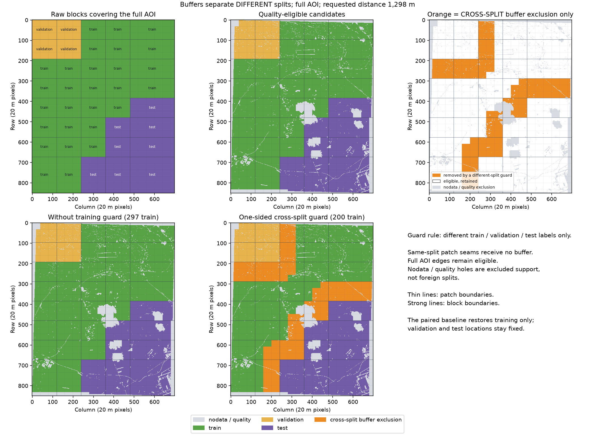
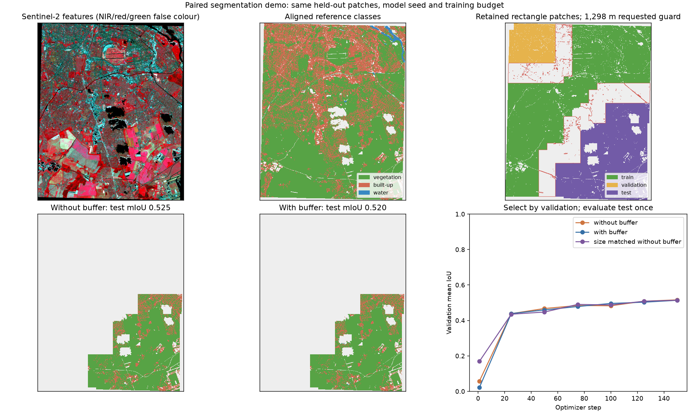

# EO Spatial Split Planner — reference patch extraction demo

An MCP server for EVE that measures spatial autocorrelation in continuous Earth Observation data and generates a fixed 2-D patch grid using the checkpoint's block-assignment and extraction procedure. Groups form seeded compact split regions, lower-priority conflicting patches are excluded by a one-sided guard, and paired datasets preserve common held-out support. The notebook trains a small CPU segmentation CNN on real imagery and inspects extracted `.npy` arrays, metadata and training statistics.

The implementation is aligned with the variogram subset of the reference repository's frozen checkpoint [`ac7dfc6`](https://github.com/stefanopitton/lulc-classification/tree/ac7dfc6578c2c408c87398e15073354752bbd32b): [scientific functions](https://github.com/stefanopitton/lulc-classification/blob/ac7dfc6578c2c408c87398e15073354752bbd32b/src/lulc/validation/autocorrelation.py), [configuration](https://github.com/stefanopitton/lulc-classification/blob/ac7dfc6578c2c408c87398e15073354752bbd32b/config/analysis.toml), and [worked example](https://github.com/stefanopitton/lulc-classification/blob/ac7dfc6578c2c408c87398e15073354752bbd32b/notebooks/autocorrelation.py). That checkpoint also contains additional estimators; `PROCEDURE.md` selects only its variogram and spherical model for this POC. Here `partial_sill` is the spherical model's second coefficient, and output `sill` means the total `nugget + partial_sill`.

## Full-AOI groups, patch extraction and paired masks

The submission notebook is [`START_HERE.ipynb`](../../START_HERE.ipynb); [`EO_SPATIAL_SPLIT_PLANNER.ipynb`](../../EO_SPATIAL_SPLIT_PLANNER.ipynb) contains the detailed retraining workflow. Both inspect actual data, MCP calls and reviewed EVE evidence.

The primary layout is `patch_layout="reference_blocks"`, adapted from the checkpoint's `scripts/04_extract_patches.py`. A fixed grid of **32 × 40-pixel model patches** is grouped using nominal **96 × 120-pixel assignment groups**. The default `edge_policy="extend"` extends the final groups to the image boundary, covering the full **850 × 699** scene with an **8 × 5 group grid** and **27 × 18 patch grid**. The terminal patches are clipped to the actual source extent (18 pixels high and/or 19 wide). There are no bottom/right crop strips; nodata and quality failures remain separately excluded.

Configurable `split_ratios` default to **[0.7, 0.1, 0.2]** for train/validation/test. The 40 seeded, spatially clustered groups realize 28 train, 4 validation and 8 test assignments before filtering. Extended edge groups cover different areas, and quality filtering/buffering changes patch and pixel proportions, which the report records. Seed candidates 0–199 are ranked by total retained usable pixels with all three splits nonempty. Offline extraction also requires available model classes in every retained split after quality filtering (`max_nan_fraction=0.5`); this class-aware dataset-design choice is disclosed. Imagery-only MCP planning uses geometric support without claiming class coverage.

The final retention configuration uses **`group_assignment="compact_regions"`** and **`buffer_policy="one_sided"`**. Seeded contiguous split regions reduce interface length. A priority order of test, validation, then training removes only conflicting lower-priority whole patches until the requested measured gap is met. Only different active split labels trigger a guard; same-split seams, AOI boundaries, nodata and quality rejections do not. Orange shows guard exclusions and grey shows quality/nodata exclusions.

These choices explicitly adapt the checkpoint's independent group shuffle and symmetric erosion. The upstream parity artifact applies to the reference helper subset; current compact/one-sided behavior is checked separately. Inspect geographic class composition as well as retention. The paired baseline restores eligible training patches on identical validation/test support, and actual distances determine separation; no independence or leakage label is inferred.

Extraction writes paired feature/label `.npy` arrays, metadata, sampled training statistics and portable lossless ZIP shards, each below 5 MiB. Read every path in the export manifest’s `archive_paths` to recover the complete dataset; the first shard also contains metadata and normalization statistics. Statistics sample 25% of training pixels with RNG seed 3 and include 1st/99th percentiles, median, mean and standard deviation. They remain distinct from the CNN's training-only z-score fit. The export records terminal shapes, assignment/keep flags, class counts, provenance and identical paired held-outs.

## Checkpoint scripts 00–04

| Stage | Reference task | Executed demo / scope |
| --- | --- | --- |
| `00_select_aoi.py` | Compare candidate AOIs and seasonal scene availability | Berlin AOI is explicit; full candidate survey is not rerun |
| `01_download_sentinel2.py` | Acquire aligned multiband scenes per season | Real matched-2021 scene and four calibrated bands via Planetary Computer |
| `02_create_seasonal_composite.py` | Mask scenes, median-composite seasons, append indices | Actual single-scene NDVI/NDWI are computed; seasonal medians/52-channel stack are not generated |
| `03_download_world_cover.py` | Align WorldCover, remap classes, report distribution | Actual WorldCover 2021 alignment and explicit three-class model mapping |
| `04_extract_patches.py` | Select block assignment, buffer fixed grid, export arrays/statistics | Local adaptation executed, including class-coverage selection and paired dataset exports |

The notebook links every pinned script. Full seasonal acquisition/compositing remains optional; a single scene is not presented as a seasonal composite. The checkpoint's example config uses 2022 seasonal dates with 2021 WorldCover, whereas this demo keeps image and label years matched. NDVI/NDWI are visualization-only adaptations of stage 02: the CNN still uses four reflectance bands and the variogram still uses raw B05. NDBI is not computed because SWIR is absent.

## MCP tools

| Tool | Input | Result |
| --- | --- | --- |
| `evaluate_sentinel2_autocorrelation` | WGS84 bbox, continuous band, lag in metres; optional dates/scene | Variogram estimate and accept/increase-lag decision on real Sentinel-2 |
| `evaluate_spatial_autocorrelation` | Local numeric GeoTIFF, lag, 1-based band index | The same evaluation for an imagery-tool handoff |
| `plan_sentinel2_split` | Sentinel-2 search, block/patch layout, optional guard | Block-assigned patch grid, paired masks and separation evidence |
| `plan_spatial_split` | Local raster, block/patch settings, optional guard | The same patch planning for an existing raster |

Planning accepts `patch_layout="reference_blocks"`, `patch_size_pixels=[32,40]`, `block_size_pixels=[96,120]`, `edge_policy="extend"`, `group_assignment="compact_regions"`, `buffer_policy="one_sided"`, `split_ratios=[0.7,0.1,0.2]`, `seed_candidates=200` and `max_nan_fraction=0.5`. The earlier `random_rectangles` layout remains available for explicit compatibility use. Band aliases such as `red_edge1`/`nir` resolve to `B05`/`B08`. Evaluators return rho, spherical-fit parameters, fit RSS, variance, missing fraction and per-bin accepted counts. Full reports, numeric imagery, masks and patch records are server-local files; another machine needs shared storage or transfer. Offline class-coverage extraction uses reference labels, while imagery-only MCP planning does not claim class coverage.

The optional segmentation experiment is a separate CPU runner; PyTorch is not required by the four MCP tools.

## Real 2021 segmentation comparison

The primary notebook uses Berlin `[13.30,52.35,13.50,52.50]`, with Sentinel-2 scene `S2B_MSIL2A_20210617T100559_R022_T33UUU_20210624T052802` acquired on 2021-06-17. Features are B05/B03/B04/B08 surface reflectance on B05's native 20 m grid (850 × 699 pixels, EPSG:32633). The 10 m bands are area-averaged to that grid. Per-pixel SCL classes 4/5/6 are retained, and processing-baseline calibration is recorded. Acquisition is through public Planetary Computer STAC.

ESA WorldCover 2021 v200 is nearest-neighbor aligned to the same grid, mapped to vegetation, built-up and water, with other labels ignored. Matching imagery and label years avoids using a 2021 reference for a 2024 scene. WorldCover is a **weak annual, machine-generated reference using Sentinel-1/Sentinel-2**, so the scores measure reference-map agreement rather than independent field accuracy. Annual labels can differ from land cover visible on the single acquisition date. Labels are distributed under CC BY 4.0; see the [WorldCover 2021 record](https://doi.org/10.5281/zenodo.7254221) and saved attribution.

The B05 variogram selects a **1,298.24 m** guard. The experiment trains a 5,283-parameter CNN from scratch: three 3 × 3 convolutional layers with 16 channels and ReLU, followed by a 1 × 1 class head. All conditions start from seed-42 weights and use AdamW (learning rate 0.003, weight decay 0.0001), 150 optimizer steps, batch size 8 and fixed 16 × 16 training crops on CPU. Normalization is fitted on each condition's labelled training pixels only. Validation every 25 steps selects the highest-mIoU checkpoint; the common test support is scored once per selected model.

The refreshed model results, train-patch counts, per-class IoU, reference counts and measured distances are recorded in the [segmentation report](artifacts/segmentation_benchmark/segmentation_report.json) and displayed in both executed notebooks. They compare all eligible training patches, one-sided training exclusions and a size-matched control on identical held-out support. Class frequencies are reported because overall pixel accuracy can be dominated by the most common class. No accuracy gain is assumed. Rare-class counts and errors are displayed explicitly; weak WorldCover labels measure reference-map agreement rather than independent field accuracy.

See the executed [notebook](../../EO_SPATIAL_SPLIT_PLANNER.ipynb), [data manifest](artifacts/segmentation_data/manifest.json), [patch plan](artifacts/segmentation_benchmark/benchmark_plan.json), and [trained results](artifacts/segmentation_benchmark/segmentation_report.json). Saved masks, predictions, checkpoints and figures make the comparison inspectable. The [patch-export manifest](artifacts/segmentation_benchmark/patch_exports/patch_export_manifest.json) links both extracted datasets and their training statistics.





## Variogram procedure

1. Read the selected band without normalizing it. Calculate population variance over finite pixels in float64; reject zero or non-finite variance.
2. Create 24 logarithmic bins between the native pixel size and 12,800 m, with geometric bin centers. For each source bin, draw 200,000 radii uniformly in that bin and angles uniformly over `[0, 2π)`, using `np.random.default_rng(3)`.
3. Round offsets to integer pixels, remove zero offsets, and recompute each pair's destination bin from its actual rounded distance. Draw anchors uniformly over the raster. Discard out-of-bounds partners and pairs touching non-finite values. Sampling is isotropic, and edge rejection is accepted.
4. Accumulate squared differences and counts by destination bin. Empty bins remain missing. Calculate `gamma = sum_squared_differences / (2 * counts)` and `rho = 1 - gamma / variance`.
5. Fit `gamma(h) = c0 + c1 * (1.5*t - 0.5*t**3)`, where `t = min(h/a, 1)`, using at least four populated bins. The nonnegative parameters are nugget `c0`, partial sill `c1`, and practical range `a`; total sill is `c0 + c1`. `scipy.optimize.curve_fit` uses `sigma = 1/sqrt(counts)` and the procedure's initial guess. Report fit RSS so the fit can be inspected.
6. Interpolate empirical `rho` linearly in `log(lag)` after dropping missing bins. Reject requests outside the populated bin-center range or with fewer than two populated bins.
7. Accept a requested separation only when **`rho_at_lag < 0.1` and `lag_m >= practical_range_m`**. Otherwise increase the lag and evaluate again. A failed or unresolved fit cannot establish acceptance.

Counts are accepted pairs after all exclusions, and can differ from 200,000 because rounded offsets move across source-bin boundaries. This POC uses only the variogram; it does not calculate directional Pearson curves, Moran's I, Geary's C, or an exponential fit.


## Assumptions

The AOI is one realization of a random field. Approximate stationarity and isotropy are assumed; uniform angles average directional structure away. Differencing removes dependence on an arbitrary constant mean, but **does not remove spatial trend**. Trend affects gamma and global variance, and can affect rho. Inspect the fit, accepted counts, cloud exclusions and directional structure before relying on the range. Negative rho values are retained.

The range and decision are continuous-band-specific point estimates without a significance test. Arbitrary categorical class codes have no meaningful numeric variance; use per-class indicator fields for a separate analysis. A B05-derived buffer does not prove independence in labels, other bands or repeated acquisitions. The model comparison also changes training volume, spatial support, normalization and class mix. The size-matched control reduces one confound but cannot establish a causal benefit.

## Can EVE use GIS MCP imagery?

**Yes, with a prepared numeric-raster handoff.** GIS MCP documents [`download_satellite_imagery`](https://gis-mcp.com/data-gathering/satellite_imagery/), returning a GeoTIFF `file_path` and scene metadata. A deployed GIS MCP server must be registered with EVE first; the documentation URL is not an MCP endpoint. The inspected account has no GIS MCP server enabled. **GIS acquisition was not invoked or integration-tested here**; actual pixels in the demo use this project's Planetary Computer reader. The source-audited [contract](artifacts/gis_mcp_contract.json) records this limitation and the requirements below.

Request B05 and SCL together on their common 20 m grid. Verify the returned scene ID, acquisition date, assets and AOI crop; search fallbacks can relax date/cloud constraints. Apply reflectance scale/offset from source metadata or processing baseline, plus the SCL per-pixel cloud/shadow/nodata mask. The audited GIS writer does not calibrate values or preserve scale/offset metadata. Retain a projected metre grid. Its stack writer cannot mix 10 m B03/B04/B08 with 20 m B05/SCL directly; obtain and align additional bands separately for the four-band model.

`file_path` is local to the GIS server. Share storage or transfer it using that server's documented `/storage/download` route before passing the prepared path to `evaluate_spatial_autocorrelation` and `plan_spatial_split`. Scene cloud percentage alone is not a pixel mask, and rendered previews are unsuitable scientific input.

## Reproduce

From the `agentic-eo` directory:

```bash
python3 -m venv .venv
.venv/bin/python -m pip install -r requirements.txt pytest
.venv/bin/python -m pip install -r requirements-demo.txt
.venv/bin/python segmentation_data.py
.venv/bin/python run_segmentation.py --steps 150 --split-ratios 0.7 0.1 0.2
.venv/bin/python -m pytest tests -q
.venv/bin/python test.py
```

Data acquisition reuses matching cached inputs unless `--force` is passed. The model runner retrains from those real rasters; it uses the full procedure defaults of 24 bins, 200,000 attempted pairs per source bin and variogram sampling seed 3. Both notebooks replay trained artifacts by default; set `TRAIN_MODELS=True` to retrain; `RECOMPUTE_IMAGES=True` refreshes imagery. The saved [variogram comparison](artifacts/reference_validation.json) and [patch-source comparison](artifacts/patch_reference_validation.json) record parity with the frozen checkpoint. The latter extracts the actual upstream functions and records source hashes, geometry comparisons and explicit adaptations. To replay the source comparison, point `.venv/bin/python validate_patches.py --reference-root /path/to/lulc-classification` at a checkout of the pinned commit.

Start the MCP server with:

```bash
.venv/bin/python server.py --transport stdio
.venv/bin/python server.py --transport http
```

HTTP uses port 8000 and `/mcp`. `EO_SPLIT_OUTPUT_DIR` selects persistent artifact storage; otherwise a server temporary directory is used. Local rasters must be north-up with square pixels and a projected metre CRS, with at most 32 million pixels. Remote Sentinel-2 acquisition is capped at one million pixels and a one-degree AOI span per axis.

Example `plan_spatial_split` arguments:

```json
{
  "raster_path": "/shared/sentinel2_reflectance_20m.tif",
  "band_index": 1,
  "seed": 3,
  "patch_layout": "reference_blocks",
  "patch_size_pixels": [32, 40],
  "block_size_pixels": [96, 120],
  "edge_policy": "extend",
  "group_assignment": "compact_regions",
  "buffer_policy": "one_sided",
  "split_ratios": [0.7, 0.1, 0.2],
  "seed_candidates": 200,
  "max_nan_fraction": 0.5
}
```

Omitting `buffer_m` measures a sufficient guard from the variogram. An explicit guard is reported with its own decision and can be rejected scientifically even if a geometric split is feasible. An imagery-discovery scene ID can be passed as `item_id` to a Sentinel-2 tool.

## EVE and draft submission

The exact live prompts, both replies, verified results and corrections are recorded in [EVE_PROMPT_AND_OUTPUT.md](../../EVE_PROMPT_AND_OUTPUT.md).

Gateway discovery and live EVE traces are saved under `artifacts/`. The recorded account did not expose a dedicated Sentinel-2 downloader. The actual 2021 cache was acquired through this project's Planetary Computer reader; the current EVE replay starts from that numeric raster and does not reacquire imagery. Inspect trace verification, schema/geometry version and `review_notes` before treating model prose as evidence. The saved EVE replay validates an earlier reference-block policy. Current compact-region/one-sided execution is demonstrated through the actual local MCP call; historical agent evidence is not claimed as a test of the new policy. The raw model answer is preserved with review notes; use only the actual saved artifact paths and machine-computed results. Older successful traces do not validate later implementations. The saved EVE trace uses the cached actual 2021 Sentinel-2 raster through the local evaluator and planner and predates the compact/one-sided retention update; it does not download imagery again or train a CNN. The matched-2021 segmentation experiment is a separate CPU run on the same data. Earlier 2024 remote-acquisition traces are historical.

Live EVE replay requires the development repository helpers and its `.env`. The exact historical trace and scope notes are included in this package.

The registry draft is staged under this server directory, with proposed wording in [`PR_DESCRIPTION.md`](PR_DESCRIPTION.md). Refresh the staged copy and run the development repository validation command after changes. The optional PyTorch demo is separate from the base server; Docker build and publishing status are separate from numerical, geospatial and MCP validation. This remains a draft demo.
