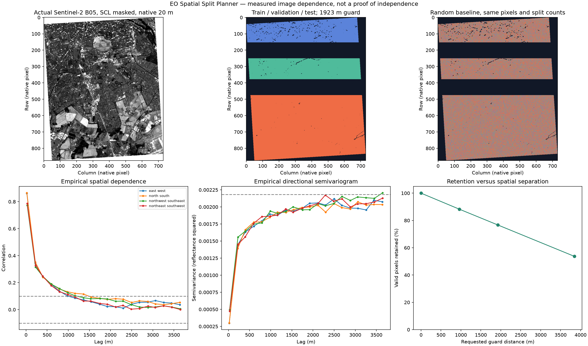

# EO Spatial Split Planner

An MCP server that converts measured spatial dependence in a numeric EO raster into reproducible train/validation/test partitions. It implements the [concept note](https://docs.google.com/document/d/12IIlu0eEh_bVcY3pnii98iE5CrnEY80DatgcOOmFLEM/edit) with an empirical range heuristic, buffered geographic stripes, a random baseline, and reviewable data-retention evidence.

| Tool | Purpose |
| --- | --- |
| `plan_sentinel2_split` | Read actual Sentinel-2 L2A pixels from public Planetary Computer STAC and plan partitions. |
| `plan_spatial_split` | Plan partitions for a cloud-masked GeoTIFF already on the MCP server filesystem. |

The Sentinel-2 tool takes `bbox=[west,south,east,north]`, ISO `start_date` and `end_date`, and defaults to red-edge `band="B05"`, `seed=42`, and `split_ratios=[0.6,0.2,0.2]`. An optional `item_id` pins a scene. `buffer_m=None` measures an exploratory range; a numeric value overrides it. `patch_radius_m` reserves additional space around ML sample centers. Date spans are capped at 366 days; native reads at 1 million pixels. Local inputs must use square, north-up pixels in a projected metre CRS.

Responses contain counts, achieved proportions, dependence status, a random comparison, separation checks, provenance, and server-local GeoTIFF/JSON paths. Output mask codes are `0=invalid_or_buffer`, `1=train`, `2=validation`, `3=test`. A remote client needs an artifact transfer mechanism to download server-local files. Outputs default to a temporary directory; `EO_SPLIT_OUTPUT_DIR` selects another location.

## Method

The estimator samples at most 20,000 valid pairs per lag and direction over 20 lag bins, to about one quarter of the smaller raster dimension. It measures paired Pearson correlation and empirical semivariance in horizontal, vertical and two diagonal directions. The third of three consecutive bins with absolute correlation at most 0.1 in all directions defines the proposed buffer. If this does not occur, the largest tested distance is marked provisional; it does not establish sufficient decorrelation. Constant signals require an explicit buffer.

Three contiguous geographic stripes approximate the requested ratios after guard exclusions. All retained pixels participate in exact Euclidean distance-transform checks. Subtracting a pixel diagonal and two patch radii yields a conservative lower bound on footprint separation. The baseline randomly shuffles exactly the same retained pixels and split counts. Seeds fix pair sampling, stripe order and the baseline.

This is a draft planning heuristic, without fitted variogram models, checkerboard partitions or class stratification. Spectral decorrelation does not establish label/model independence, prevent every kind of leakage, or estimate model accuracy. Geographic, temporal, overlapping-scene and class-distribution effects need task-specific evaluation.

Sentinel-2 reads preserve native resolution. SCL is aligned by nearest neighbor and only classes 4, 5 and 6 are retained. Reflectance scaling uses STAC metadata or the recorded processing-baseline convention. Raw previews are unsuitable inputs. Catalog selection chooses the least cloudy covering scene on the first 100-item search page, then item ID; pin a scene for replay.

## Run

From this server directory:

```bash
python -m pip install -r requirements.txt pytest
python test.py
python -m pytest tests -q
python test.py --real
python server.py --transport stdio
python server.py --transport http
```

HTTP listens on `0.0.0.0:8000/mcp` with stateless streamable HTTP. Stdio is for a subprocess MCP client. No account or API key is needed for public Sentinel-2 access. Signed archive URLs are transient and omitted from saved evidence.

From an EVE registry checkout, the standard container command is:

```bash
docker build -f shared/Dockerfile servers/eo-spatial-split-planner/
```

The shared Dockerfile is Python 3.13 slim. A Docker build was not performed during this draft because the local daemon was unavailable.

## Recorded real-data experiment

The stdio MCP test analyzed southern Berlin, bbox `[13.30,52.35,13.50,52.50]`, using scene `S2A_MSIL2A_20240828T102021_R065_T32UQD_20240828T150452`, acquired 2024-08-28. B05 has native 20 m pixels, EPSG:32632, and a cropped 876 × 731 grid.

| Result | Measured value |
| --- | ---: |
| Valid pixels before buffering | 562,947 |
| Proposed guard | 1,923.33 m |
| Verified minimum center distance | 1,960 m |
| Conservative minimum footprint-gap lower bound | 1,931.72 m |
| Train / validation / test pixels | 258,623 / 86,580 / 86,654 |
| Valid pixels retained | 76.71% |
| Random baseline minimum center distance | 20 m |
| Random baseline footprint-gap lower bound | 0 m |

Buffers 0 / 961.67 / 1,923.33 / 3,846.66 m retain 100 / 88.23 / 76.71 / 53.67% of valid pixels. Guard loss is measured after cloud/nodata screening. See [full report](artifacts/real_demo_report.json), [sensitivity](artifacts/sensitivity.json), numeric GeoTIFFs and the diagnostic:



The source hackathon integration also tested the actual EVE model invoking hosted `reverse_geocode_place` and the local planner successfully. The current account exposed no Sentinel-2 download tool; numeric imagery was acquired directly by this planner through public STAC. Sanitized [EVE trace](artifacts/eve_demo.json) and [gateway discovery](artifacts/eve_gateway_discovery.json) record that distinction. Raw model prose is retained, with review corrections in `review_notes`; machine-computed diagnostics govern the claims above. The optional EVE client script and executed notebook belong to the accompanying hackathon workspace, not this standalone server package.

The implementation passed 29 scientific and geospatial unit tests, stdio protocol discovery/calls on synthetic and actual imagery, the EVE integration, and notebook execution. Production artifact distribution and Docker deployment remain outside this draft's tested scope.

Sources: [Planetary Computer Sentinel-2 access example](https://github.com/microsoft/PlanetaryComputerExamples/blob/main/datasets/sentinel-2-l2a/sentinel-2-l2a-example.ipynb), [Sentinel-2 L2A processing offset report](https://sentinels.copernicus.eu/documents/d/sentinel/ompc-cs-dqr-002-06-2023-i63r0-msi-l2a-dqr-july-2023), [registry contribution contract](https://github.com/eve-esa/mcp-tool-registry/blob/main/CONTRIBUTING.md).
